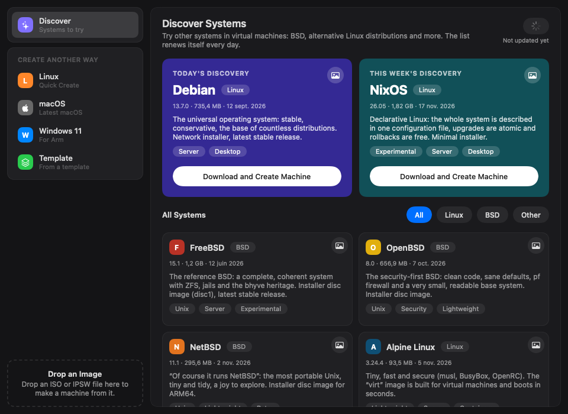

## About

**TESSERaCT** is a free macOS app that creates and runs virtual machines on Apple silicon Macs, with a self-updating catalogue of ARM64 systems to try (Linux, BSD, Haiku, Redox, OpenWrt and more). Part of the DESKTOP MAC TOOLKIT. Authors: Starbudweiser & Claude Code (Anthropic). Apache-2.0 License, provided as is, without warranty. It is a fork of [SwiftVM](https://github.com/swiftvm-app/swiftvm), whose licence and notices are kept.

  

<h1 align="center">TESSERaCT</h1>

Native macOS app for running macOS, Linux, and Windows virtual machines.

## Supported guests

- macOS
- Linux
- Windows 11 for Arm

## Top level features

- macOS guests that install and set themselves up
- Linux guests from cloud images with automatic setup
- Linux desktops that install themselves: GNOME, KDE Plasma, Xfce, Cinnamon
- Windows 11 that downloads from Microsoft and installs itself, logged in and with its drivers
- Setup scripts for everything else a new machine needs, in one file you write
- `ssh <machine>` from your Mac
- Snapshots and duplicates that share unchanged disk blocks on APFS
- Templates: save a machine you set up, and create new ones from it
- Suspend and resume
- Shared folders and clipboard
- Port forwarding
- USB devices and disk images
- Lives in the menu bar
- `tctl` command-line tool
- Automation for scripts and AI agents: [see and work a guest's desktop](docs/features/automation.md#the-desktop), at login screens too, run commands in it, and copy files, from the `tctl` command or [its MCP server](docs/features/automation.md#mcp)

## Install

TESSERaCT runs on macOS 27 or newer, on Apple silicon.

Download `TESSERaCT.zip` from the [latest release](https://github.com/starbudweiser/TESSERaCT/releases/latest), unzip it and move TESSERaCT to your Applications folder. The build is signed with a Developer ID certificate and notarized.

See [Getting started](docs/user-guide/getting-started.md) for your first virtual machine, the `tctl` command, and beta builds.

## Documentation

See [docs](https://swiftvm.app/docs).

## License

[Apache-2.0](LICENSE)

## Support / Soutenir

This app is free. If it is useful to you, you can support the project (optional, no reward expected): [GitHub Sponsors](https://github.com/sponsors/starbudweiser).

Cette appli est gratuite. Si elle vous est utile, vous pouvez soutenir le projet (facultatif, sans contrepartie) : [GitHub Sponsors](https://github.com/sponsors/starbudweiser).
